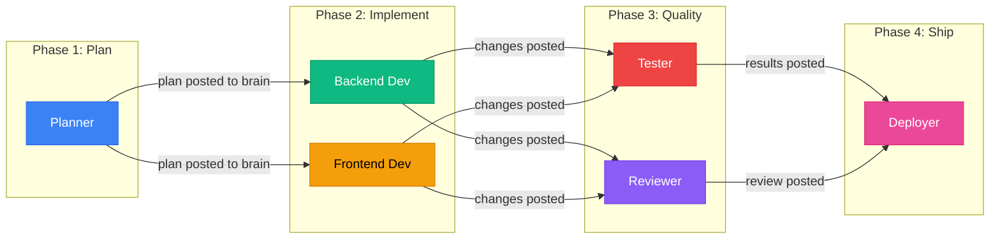
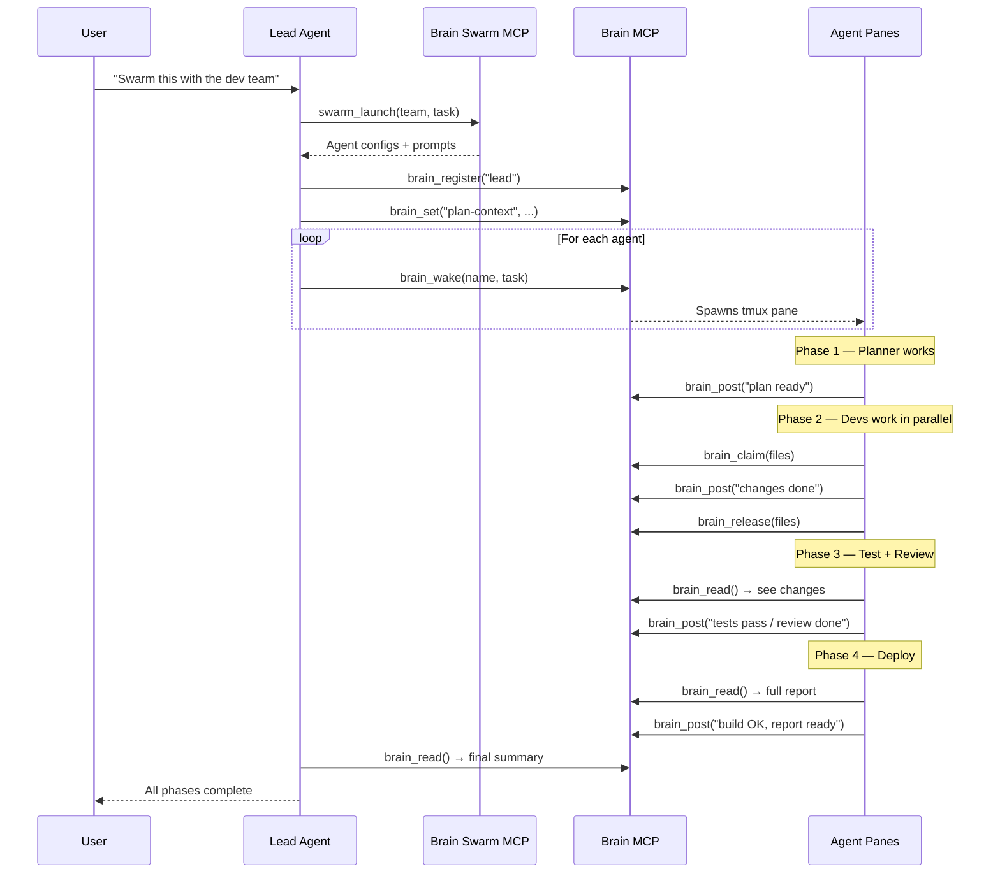

<div align="center">

<br>

# Brain Swarm

**Pipeline-model agent orchestration for Claude Code**

Define teams of specialized agents. Launch them in parallel.<br>Watch them plan, build, test, review, and ship — all coordinated through [Brain MCP](https://github.com/DevvGwardo/brain-mcp).

<br>

[](LICENSE)
[](https://nodejs.org)
[](https://modelcontextprotocol.io)
[](https://github.com/DevvGwardo/brain-mcp)
[](https://github.com/DevvGwardo/brain-swarm)

<br>

[Install](#install) · [Teams](#teams) · [Pipeline Model](#pipeline-model) · [Custom Teams](#custom-teams) · [How It Works](#how-it-works)

<br>

</div>

---

## Install

**Requires [Brain MCP](https://github.com/DevvGwardo/brain-mcp)** — install it first if you haven't.

```bash
git clone https://github.com/DevvGwardo/brain-swarm.git ~/brain-swarm && cd ~/brain-swarm && npm install && npm run build && ./install.sh
```

Restart Claude Code. Done.

---

## Usage

Just say what you want:

```
Swarm this codebase with the dev team
```

```
Run the audit team on this project
```

```
Launch the dev team to add authentication to this app
```

Claude reads the team template, spawns 6 agents in tmux split panes, and they work through the pipeline automatically.

---

## Pipeline Model

Each team runs as a **pipeline** — agents execute in phases, with each phase feeding into the next:



<div align="center">

**Parallel within phases, sequential across phases.**<br>
Agents self-coordinate through timed delays and brain messaging.

</div>

---

## Teams

### Dev Team

6-agent full-stack development pipeline.

| Agent | Role | Phase | Color |
|:------|:-----|:------|:------|
| `planner` | Analyzes task, creates implementation plan | Plan | Blue |
| `backend-dev` | Implements API/server changes | Implement | Emerald |
| `frontend-dev` | Implements UI/component changes | Implement | Amber |
| `tester` | Writes and runs tests | Quality | Red |
| `reviewer` | Reviews all code changes | Quality | Violet |
| `deployer` | Runs build, generates report | Ship | Pink |

### Audit Team

6-agent security and quality audit pipeline.

| Agent | Role | Phase | Color |
|:------|:-----|:------|:------|
| `security-scanner` | OWASP top 10 vulnerability scan | Scan | Red |
| `type-checker` | TypeScript type safety audit | Scan | Blue |
| `perf-auditor` | Performance and optimization audit | Scan | Amber |
| `fixer` | Fixes top issues from each scanner | Fix | Emerald |
| `verifier` | Verifies fixes are correct | Verify | Violet |
| `reporter` | Generates comprehensive audit report | Verify | Pink |

---

## How It Works



### The Pipeline Loop

Agents coordinate through **timing and brain messaging**:

1. **Phase 1** agents start immediately
2. **Phase 2** agents wait (delay) for Phase 1 to finish, then read the brain
3. **Phase 3** agents wait longer, then read all previous results
4. **Phase 4** agents wait longest, then compile everything

Each agent:
- Reads previous phase results via `brain_read`
- Claims files with `brain_claim` (prevents conflicts)
- Posts its work to the brain with `brain_post`
- Releases files with `brain_release`

---

## Custom Teams

Create your own team by adding a JSON file to `~/brain-swarm/teams/`:

```json
{
  "name": "my-team",
  "description": "Custom 4-agent team",
  "pipeline": [
    { "phase": "analyze", "agents": ["scanner"], "parallel": false },
    { "phase": "fix", "agents": ["fixer-a", "fixer-b"], "parallel": true },
    { "phase": "verify", "agents": ["checker"], "parallel": false }
  ],
  "agents": {
    "scanner": {
      "role": "Code Scanner",
      "color": "#3B82F6",
      "prompt": "Scan the codebase for issues..."
    },
    "fixer-a": {
      "role": "Fixer A",
      "color": "#10B981",
      "delay": 30,
      "prompt": "Fix backend issues found by scanner..."
    },
    "fixer-b": {
      "role": "Fixer B",
      "color": "#F59E0B",
      "delay": 30,
      "prompt": "Fix frontend issues found by scanner..."
    },
    "checker": {
      "role": "Verification",
      "color": "#8B5CF6",
      "delay": 90,
      "prompt": "Verify all fixes are correct..."
    }
  }
}
```

Fields:
- `delay` — seconds to wait before starting (lets previous phase finish)
- `color` — hex color for the tmux pane border
- `parallel` — whether agents in this phase run simultaneously

---

## Architecture

```
┌──────────────────────────────────────────┐
│              Brain Swarm MCP             │
│  (team templates + orchestration logic)  │
└────────────────┬─────────────────────────┘
                 │ swarm_launch → agent configs
                 ▼
┌──────────────────────────────────────────┐
│               Brain MCP                  │
│  (communication + coordination layer)    │
│                                          │
│  brain_wake → spawns tmux panes          │
│  brain_post/read → messaging             │
│  brain_claim/release → file locking      │
│  brain_set/get → shared state            │
└────────────────┬─────────────────────────┘
                 │
    ┌────────────┼────────────┐
    ▼            ▼            ▼
┌────────┐ ┌────────┐ ┌────────┐
│ Agent 1│ │ Agent 2│ │ Agent 3│  ...
│ (tmux) │ │ (tmux) │ │ (tmux) │
└────────┘ └────────┘ └────────┘
```

---

<div align="center">

<br>

Node.js 18+ &nbsp;&middot;&nbsp; [Brain MCP](https://github.com/DevvGwardo/brain-mcp) &nbsp;&middot;&nbsp; tmux &nbsp;&middot;&nbsp; Claude Code

[MIT License](LICENSE)

<br>

</div>
